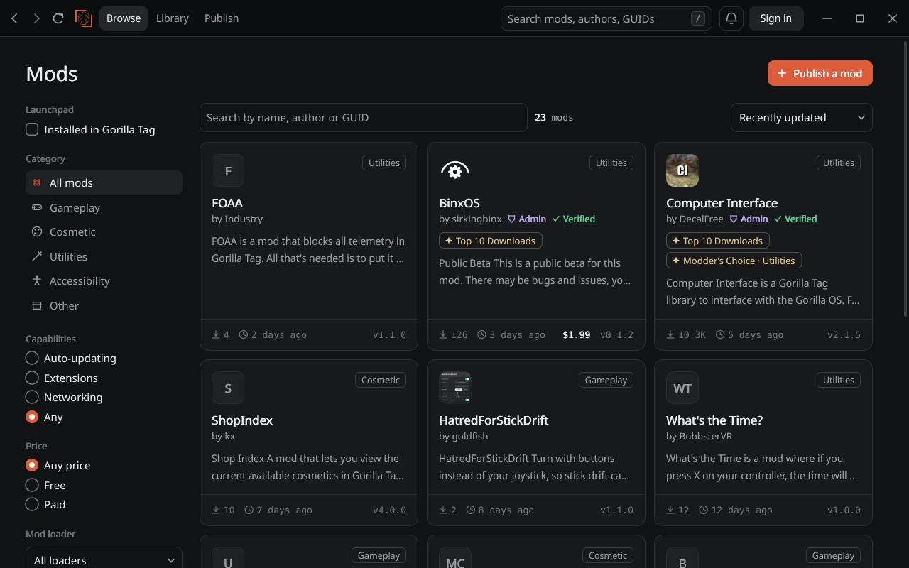

# MonkeForge Launchpad

You can get releases & information about MonkeForge Launchpad at https://monkeforge.org/software/launchpad.

MonkeForge Launchpad is made by MonkeForge and stays under its non-commercial license, see LICENSE.md.
